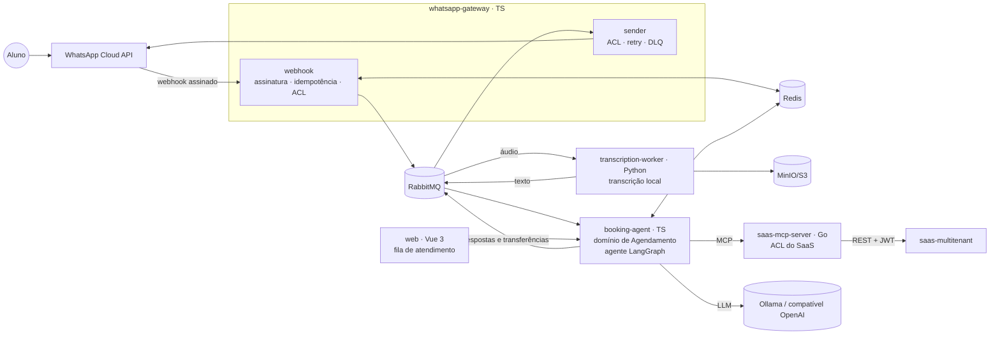

# whatsapp-booking-agent


Agente de agendamento via WhatsApp para os alunos de estúdios de yoga e pilates (domínio fictício). Mostra horários, reserva, cancela e coloca na lista de espera usando a API do [SaaS de estúdios](https://github.com/JohnnyMatteus/saas-multitenant), com escopo fechado em aulas e reservas e transferência para uma pessoa quando o assunto sai da agenda.

## O problema

Nos estúdios que usam o SaaS, boa parte dos pedidos chega pelo WhatsApp: "tem aula amanhã cedo?", "me tira da de quinta", "lotou? me coloca na fila". A recepção responde à mão, copia o horário da grade e faz a reserva no sistema. No pico, a resposta demora e a vaga vai para quem pediu depois.

O agente atende esses pedidos no número do estúdio, 24 horas, sem inventar horário e sem opinar sobre o que não é agenda:

- **Só a WhatsApp Cloud API oficial**, com webhook assinado e idempotente.
- **Escopo fechado**: desde 15/01/2026 a Meta proíbe chatbots de uso geral. Pedido fora de aulas e reservas recebe uma recusa educada.
- **Só cita horários que vieram das ferramentas**, garantido por código e provado por teste.
- **Transferência para humano** por pedido explícito, tema sensível (saúde, cobrança, reclamação) ou falha repetida. Transferida, a conversa entra na fila de atendimento e o bot para de responder.

## Arquitetura

Clean Architecture + Hexagonal + DDD, em microsserviços. Detalhes no [design doc](docs/design-doc.md).



| Serviço | Stack | Papel | Estado nesta rodada |
| --- | --- | --- | --- |
| [`services/whatsapp-gateway`](services/whatsapp-gateway) | TypeScript, Fastify | webhook (assinatura, idempotência, ACL de entrada) e sender (ACL de saída, retry, DLQ) | funcional, com testes de contrato e integração |
| [`services/booking-agent`](services/booking-agent) | TypeScript, LangGraph.js | domínio, casos de uso, agente, API do painel | funcional, domínio completo e grafo testados com LLM falso |
| [`services/saas-mcp-server`](services/saas-mcp-server) | Go, `modelcontextprotocol/go-sdk` | `listar_horarios`, `reservar`, `cancelar`, `entrar_lista_espera` e ACL do SaaS | funcional, com testes de contrato |
| [`services/transcription-worker`](services/transcription-worker) | Python, faster-whisper | áudio → texto local, atrás de porta | esqueleto com caso de uso testado |
| [`web`](web) | Vue 3, Vuetify, TanStack Query | painel do estúdio | fila, conversa com costura e carimbo de fonte, métricas e escopo (tema Recado) |
| [`packages/*`](packages) | TypeScript | contratos da fila, adaptador RabbitMQ, observabilidade | funcional |

**Anti-Corruption Layer em dois pontos** ([ADR 0002](docs/adr/0002-anti-corruption-layer.md)): o payload da Cloud API vira comandos do domínio (`MensagemRecebida`, `PedidoDeReserva`, `PedidoDeCancelamento`) e as respostas viram texto, botões ou lista da Meta; o modelo do SaaS (tenant, sessão, reserva, `problem+json`) vira Aula, Reserva e erros de domínio com mapeamento explícito. Nenhum tipo da Meta ou do SaaS entra no domínio.

## Como rodar

Pré-requisitos: Docker 27+, Node 22+ com pnpm 12, Go 1.26+, Python 3.12+.

```bash
cp .env.example .env
make install          # dependências locais (pnpm, Go e venv do worker)
make up               # serviços, RabbitMQ, Redis, MinIO, mocks da Cloud API e do SaaS, observabilidade
make up-llm           # opcional: Ollama local e o modelo do LLM_MODEL
make seed             # envia ao webhook uma mensagem assinada como a Meta
make seed TEXT="me conta uma piada"
```

| Endereço | O quê |
| --- | --- |
| http://127.0.0.1:8080/webhook | webhook (GET de verificação e POST assinado) |
| http://127.0.0.1:9090/__admin/requests | respostas que o bot "enviou" ao mock da Cloud API |
| http://127.0.0.1:5173 | painel do estúdio (Recado) |
| http://127.0.0.1:15672 | RabbitMQ (filas, retry e DLQ) |
| http://127.0.0.1:16686 · :9091 · :3000 | Jaeger · Prometheus · Grafana |

Sem o `saas-multitenant`, o servidor MCP fala com um WireMock que devolve aulas com datas relativas a hoje. Para usar o SaaS real pela rede compartilhada do portfólio: `make network && make up-portfolio`.

## Como testar

```bash
make lint             # ESLint, typecheck (tsc e vue-tsc), gofmt + go vet, ruff + mypy
make test             # unitários e de contrato, sem Docker e sem LLM real
make test-integration # Redis e RabbitMQ reais via testcontainers (roda no CI)
```

O que vale olhar:

- [`tests/agent/slot-citation.test.ts`](services/booking-agent/tests/agent/slot-citation.test.ts): o LLM falso insiste em horário inventado e a resposta final só tem horários das ferramentas.
- [`tests/agent/scope-and-handoff.test.ts`](services/booking-agent/tests/agent/scope-and-handoff.test.ts): recusa sem chamar o LLM, transferência por pedido, tema sensível e falha repetida.
- [`tests/domain/`](services/booking-agent/tests/domain): invariantes dos quatro agregados.
- [`tests/contract/`](services/whatsapp-gateway/tests/contract) e [`internal/adapters/saas/client_test.go`](services/saas-mcp-server/internal/adapters/saas/client_test.go): contratos das duas ACLs com payloads reais anonimizados.

O CI ([`ci.yml`](.github/workflows/ci.yml)) roda um job por serviço, mais os testes de integração, o build das imagens e a validação da infraestrutura.

## Decisões principais

| ADR | Decisão |
| --- | --- |
| [0001](docs/adr/0001-mapa-de-servicos.md) | Mapa de serviços; o sender fica no gateway, em processo separado, para a ACL da Cloud API ficar num lugar só |
| [0002](docs/adr/0002-anti-corruption-layer.md) | ACL para a Cloud API e para o SaaS, com testes de contrato, e o custo de mantê-la |
| [0003](docs/adr/0003-escopo-fechado-e-recusas.md) | Só a Cloud API oficial; escopo fechado decidido por regra determinística e LLM no ambíguo |
| [0004](docs/adr/0004-transferencia-para-humano.md) | Transferência por pedido, tema sensível ou 2 falhas seguidas; o bot silencia |
| [0005](docs/adr/0005-idempotencia.md) | Idempotência pelo id da mensagem no webhook e na Conversa |
| [0006](docs/adr/0006-mensageria-rabbitmq.md) | RabbitMQ: exchange topic, filas quorum, retry com TTL e DLQ por consumidor |
| [0007](docs/adr/0007-infraestrutura-local-e-servicos-emulados.md) | Docker com profiles, WireMock no lugar da Meta e do SaaS, MinIO para áudio |
| [0008](docs/adr/0008-agente-langgraph-como-adapter.md) | Agente LangGraph como adapter: o LLM não chama ferramentas, saída por schema com um retry, citação garantida por código |
| [0009](docs/adr/0009-vinculo-telefone-aluno-conta-de-servico.md) | Vínculo telefone → aluno por opt-in (`vincular 123456`) e conta de serviço por estúdio no Keycloak, sem token exchange com impersonation |

Roteiros do núcleo, com perguntas de entrevista: [escopo e recusas](docs/roteiros/escopo-e-recusas.md), [transferência para humano](docs/roteiros/transferencia-para-humano.md) e [modelo de domínio](docs/roteiros/modelo-dominio-agendamento.md).

## Trade-offs

- **Grafo com nós fixos em vez de agente livre**: perde naturalidade em pedidos compostos ("cancela a de terça e marca a de quarta" vira dois turnos) e ganha garantias testáveis.
- **Três runtimes** (Node, Go, Python): mais CI e mais manutenção, em troca do SDK MCP oficial em Go e do ecossistema de transcrição em Python.
- **Publicar antes de salvar**: uma queda no meio gera resposta duplicada (rara) em vez de perdida. Outbox está nos próximos passos.
- **Tradutores duplicados de propósito** (Go e TypeScript): custo de manutenção para proteger os agregados mesmo contra um servidor MCP com bug.
- **Duas falhas para transferir**: agressivo, para o aluno não repetir a pergunta três vezes.

## Próximos passos

3. Outbox no booking-agent e serialização por contato na fila.
4. Templates aprovados para avisar promoção da lista de espera e lembrar aula.
5. Flow de agendamento publicado na Meta (o tradutor já entende a conclusão).
6. transcription-worker com retry, DLQ, métricas e teste de integração com MinIO.
7. Testes de mutação no domínio e de carga no webhook no CI.
8. Login OIDC no painel, conversas e métricas de atendimento; deploy com Helm atrás do `platform-edge`.

## Licença

[MIT](LICENSE)
