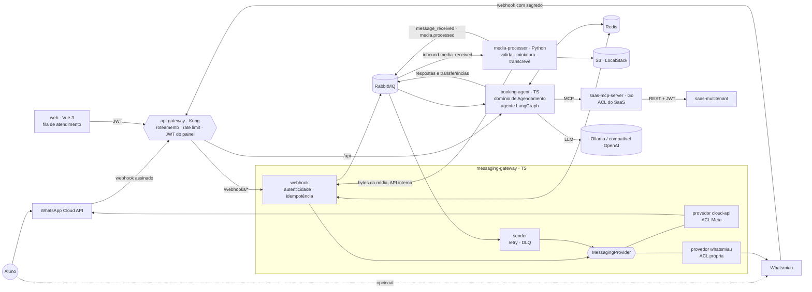

# whatsapp-booking-agent


Agente de agendamento via WhatsApp para os alunos de estúdios de yoga e pilates (domínio fictício). Mostra horários, reserva, cancela e coloca na lista de espera usando a API do [SaaS de estúdios](https://github.com/JohnnyMatteus/saas-multitenant), com escopo fechado em aulas e reservas e transferência para uma pessoa quando o assunto sai da agenda.

## O problema

Nos estúdios que usam o SaaS, boa parte dos pedidos chega pelo WhatsApp: "tem aula amanhã cedo?", "me tira da de quinta", "lotou? me coloca na fila". A recepção responde à mão, copia o horário da grade e faz a reserva no sistema. No pico, a resposta demora e a vaga vai para quem pediu depois.

O agente atende esses pedidos no número do estúdio, 24 horas, sem inventar horário e sem opinar sobre o que não é agenda:

- **WhatsApp Cloud API oficial por padrão**, com webhook assinado e idempotente. Cada estúdio pode optar pelo Whatsmiau (não oficial; [riscos no ADR 0010](docs/adr/0010-messaging-gateway-e-provedores-de-whatsapp.md)); o domínio e o agente não sabem qual provedor atende.
- **Escopo fechado**: desde 15/01/2026 a Meta proíbe chatbots de uso geral. Pedido fora de aulas e reservas recebe uma recusa educada.
- **Só cita horários que vieram das ferramentas**, garantido por código e provado por teste.
- **Transferência para humano** por pedido explícito, tema sensível (saúde, cobrança, reclamação) ou falha repetida. Transferida, a conversa entra na fila de atendimento e o bot para de responder.

## Arquitetura

Clean Architecture + Hexagonal + DDD, em microsserviços. Detalhes no [design doc](docs/design-doc.md).



| Serviço | Stack | Papel | Estado nesta rodada |
| --- | --- | --- | --- |
| [`infra/gateway`](infra/gateway) | Kong OSS DB-less | entrada única: roteia webhooks (sem JWT) e a API do painel (JWT), rate limit | funcional, com smoke no CI |
| [`services/messaging-gateway`](services/messaging-gateway) | TypeScript, Fastify | serviço de integrações: porta `MessagingProvider`, provedores Cloud API e Whatsmiau por estúdio, webhook, status de entrega, mídia e sender | funcional, com testes de contrato das duas ACLs e integração |
| [`services/booking-agent`](services/booking-agent) | TypeScript, LangGraph.js | domínio, casos de uso, agente, API do painel | funcional, domínio completo e grafo testados com LLM falso |
| [`services/saas-mcp-server`](services/saas-mcp-server) | Go, `modelcontextprotocol/go-sdk` | `listar_horarios`, `reservar`, `cancelar`, `entrar_lista_espera` e ACL do SaaS | funcional, com testes de contrato |
| [`services/media-processor`](services/media-processor) | Python, Pillow, boto3, faster-whisper | áudio e imagem: valida tipo e tamanho, guarda no S3, miniatura, transcrição local, evento `MediaProcessed` | funcional, caso de uso testado com transcritor falso |
| [`web`](web) | Vue 3, Vuetify, TanStack Query | painel do estúdio | fila, conversa com costura e carimbo de fonte, métricas e escopo (tema Recado) |
| [`packages/*`](packages) | TypeScript | contratos da fila, adaptador RabbitMQ, observabilidade | funcional |

**Anti-Corruption Layer em dois pontos** ([ADR 0002](docs/adr/0002-anti-corruption-layer.md)): o payload de cada provedor (Cloud API ou Whatsmiau, uma ACL cada) vira comandos do domínio (`MensagemRecebida`, `PedidoDeReserva`, `PedidoDeCancelamento`) e as respostas viram texto, botões ou lista da Meta; o modelo do SaaS (tenant, sessão, reserva, `problem+json`) vira Aula, Reserva e erros de domínio com mapeamento explícito. Nenhum tipo de provedor ou do SaaS entra no domínio.

## Como rodar

Pré-requisitos: Docker 27+, Node 22+ com pnpm 12, Go 1.26+, Python 3.12+.

```bash
cp .env.example .env
make install          # dependências locais (pnpm, Go e venv do media-processor)
make up               # serviços, RabbitMQ, Redis, S3 local (LocalStack), mocks da Cloud API e do SaaS, observabilidade
make up-llm           # opcional: Ollama local e o modelo do LLM_MODEL
make seed             # envia ao webhook (via api-gateway) uma mensagem assinada como a Meta
make up-whatsmiau     # opcional: estudio-sol atendido pelo Whatsmiau (mock) e estudio-lotus na Cloud API
make seed-whatsmiau   # mensagem no formato do Whatsmiau, com o segredo da instância
make panel-token      # access token de desenvolvimento do Keycloak (USER_NAME=ana.lotus|bia.lotus|caio.sol)
make seed TEXT="me conta uma piada"
```

| Endereço | O quê |
| --- | --- |
| http://127.0.0.1:8000/webhooks/cloud-api · /webhooks/whatsmiau | api-gateway: webhooks dos provedores (sem JWT; a autenticidade é validada no messaging-gateway) |
| http://127.0.0.1:8000/api | api-gateway: API do painel (exige o JWT do Keycloak; o booking-agent não tem porta no host); o smoke das políticas roda no CI |
| http://127.0.0.1:9090/__admin/requests | respostas que o bot "enviou" ao mock da Cloud API |
| http://127.0.0.1:5173 | painel do estúdio (Recado); entra pelo Keycloak (`ana.lotus@example.com` / `dev-only-ana`) |
| http://127.0.0.1:8180 | Keycloak de desenvolvimento (realm `wba`) |
| http://127.0.0.1:15672 | RabbitMQ (filas, retry e DLQ) |
| http://127.0.0.1:16686 · :9091 · :3000 | Jaeger · Prometheus · Grafana |

O api-gateway lê a chave pública do Keycloak só ao subir: se o contêiner do Keycloak for recriado, ele gera outro par e todo token dá 401 até `docker compose restart api-gateway`.

Para um cluster há um chart Helm em [`deploy/helm/wba`](deploy/helm/wba) (nunca instalado; ver o README dele).

Sem o `saas-multitenant`, o servidor MCP fala com um WireMock que devolve aulas com datas relativas a hoje. Para usar o SaaS real pela rede compartilhada do portfólio: `make network && make up-portfolio`.

## Como testar

```bash
make lint             # ESLint, typecheck (tsc e vue-tsc), gofmt + go vet, ruff + mypy
make test             # unitários e de contrato, sem Docker e sem LLM real
make test-integration # Redis e RabbitMQ reais via testcontainers (roda no CI)
# o CI também valida o Kong (kong config parse + smoke) e o compose com todos os profiles, e o job e2e sobe o profile core
# (Keycloak e Kong reais) e roda scripts/e2e.sh (webhook assinado até a resposta no mock da Cloud API, idempotência, painel
# autenticado, isolamento entre estúdios) e a carga no webhook com k6 (infra/load/webhook.js: 50 req/s de contatos distintos por 20 s e uma rajada de 20 mensagens do mesmo contato; o job confere que a fila do agente esvazia e a DLQ termina vazia)
```

O que vale olhar:

- [`tests/agent/slot-citation.test.ts`](services/booking-agent/tests/agent/slot-citation.test.ts): o LLM falso insiste em horário inventado e a resposta final só tem horários das ferramentas.
- [`tests/agent/scope-and-handoff.test.ts`](services/booking-agent/tests/agent/scope-and-handoff.test.ts): recusa sem chamar o LLM, transferência por pedido, tema sensível e falha repetida.
- [`tests/domain/`](services/booking-agent/tests/domain): invariantes dos quatro agregados.
- [`tests/cloud-api/`](services/messaging-gateway/tests/cloud-api), [`tests/whatsmiau/`](services/messaging-gateway/tests/whatsmiau) e [`internal/adapters/saas/client_test.go`](services/saas-mcp-server/internal/adapters/saas/client_test.go): contratos das ACLs (um por provedor e o do SaaS) com payloads anonimizados.
- [`tests/unit/multi-provider-server.test.ts`](services/messaging-gateway/tests/unit/multi-provider-server.test.ts): a mesma resposta sai pela Cloud API para um estúdio e pelo Whatsmiau para outro, sem o chamador saber.
- [`tests/test_process_media.py`](services/media-processor/tests/test_process_media.py): validação por bytes reais, miniatura com Pillow e rejeições.

O CI ([`ci.yml`](.github/workflows/ci.yml)) roda um job por serviço, mais os testes de integração, o build das imagens e a validação da infraestrutura.

## Decisões principais

| ADR | Decisão |
| --- | --- |
| [0001](docs/adr/0001-mapa-de-servicos.md) | Mapa de serviços: api-gateway, messaging-gateway, media-processor, booking-agent, servidor MCP e painel |
| [0002](docs/adr/0002-anti-corruption-layer.md) | ACL para a Cloud API e para o SaaS, com testes de contrato, e o custo de mantê-la |
| [0003](docs/adr/0003-escopo-fechado-e-recusas.md) | Cloud API oficial como padrão; escopo fechado decidido por regra determinística e LLM no ambíguo |
| [0004](docs/adr/0004-transferencia-para-humano.md) | Transferência por pedido, tema sensível ou 2 falhas seguidas; o bot silencia |
| [0005](docs/adr/0005-idempotencia.md) | Idempotência pelo id da mensagem no webhook e na Conversa |
| [0006](docs/adr/0006-mensageria-rabbitmq.md) | RabbitMQ: exchange topic, filas quorum, retry com TTL e DLQ por consumidor |
| [0007](docs/adr/0007-infraestrutura-local-e-servicos-emulados.md) | Docker com profiles, WireMock no lugar da Meta e do SaaS, LocalStack (S3) para áudio |
| [0008](docs/adr/0008-agente-langgraph-como-adapter.md) | Agente LangGraph como adapter: o LLM não chama ferramentas, saída por schema com um retry, citação garantida por código |
| [0009](docs/adr/0009-vinculo-telefone-aluno-conta-de-servico.md) | Vínculo telefone → aluno por opt-in (`vincular 123456`) e conta de serviço por estúdio no Keycloak, sem token exchange com impersonation |
| [0010](docs/adr/0010-messaging-gateway-e-provedores-de-whatsapp.md) | Messaging-gateway: porta `MessagingProvider`, Cloud API e Whatsmiau por estúdio, riscos do Whatsmiau e quando usar cada um |
| [0011](docs/adr/0011-media-processor.md) | Media-processor: valida por bytes, guarda no S3, miniatura, transcrição, `MediaProcessed` |
| [0012](docs/adr/0012-api-gateway-kong.md) | Kong DB-less: webhooks sem JWT (assinatura no serviço), painel com JWT, rate limit |
| [0013](docs/adr/0013-login-do-painel-oidc.md) | Login do painel por OIDC (Keycloak, PKCE); estúdio e papel vêm do token, validados no gateway e no booking-agent |

Roteiros do núcleo, com perguntas de entrevista: [escopo e recusas](docs/roteiros/escopo-e-recusas.md), [transferência para humano](docs/roteiros/transferencia-para-humano.md) e [modelo de domínio](docs/roteiros/modelo-dominio-agendamento.md).

## Trade-offs

- **Grafo com nós fixos em vez de agente livre**: perde naturalidade em pedidos compostos ("cancela a de terça e marca a de quarta" vira dois turnos) e ganha garantias testáveis.
- **Três runtimes** (Node, Go, Python) mais o Kong: mais CI e mais manutenção, em troca do SDK MCP oficial em Go e do ecossistema de transcrição em Python.
- **Caixa de saída no Redis em vez de banco transacional**: a Conversa e as respostas do turno são gravadas juntas por um script Lua e publicadas depois ([ADR 0014](docs/adr/0014-outbox-e-exclusao-mutua-por-contato.md)); entrega pelo menos uma vez (duplicata rara), e o lock por contato evita turnos simultâneos mas não garante ordem.
- **Tradutores duplicados de propósito** (Go e TypeScript): custo de manutenção para proteger os agregados mesmo contra um servidor MCP com bug.
- **Duas falhas para transferir**: agressivo, para o aluno não repetir a pergunta três vezes.

## Próximos passos

1. Templates `lembrete_aula` e `vaga_liberada` criados e aprovados na conta Meta (o código já os envia).
2. Flow de agendamento publicado na Meta (o tradutor já entende a conclusão).
3. Teste de integração do media-processor com RabbitMQ e S3 reais (o retry até a DLQ e a leitura da miniatura no S3 hoje só são testados sem broker nem bucket).
4. Testes de mutação no domínio (Stryker): falta adicionar a dependência e o lockfile, o que exige instalar pacotes.
5. Whatsmiau contra uma instância real (hoje só fixtures no formato documentado e mock); LID não resolvido pelo Whatsmiau (chega como `@lid`) segue ignorado: falta confirmar numa instância real se o envio aceita LID.
6. Login do painel contra um Keycloak real (hoje só o realm de desenvolvimento e provedor falso nos testes), rotação da chave pública no Kong e token de serviço por estúdio em `/internal`.
7. Instalar o chart (`deploy/helm/wba`, validado só por `helm lint` e `helm template` no CI) num cluster e ligá-lo ao gateway compartilhado do `platform-edge`.

## Licença

[MIT](LICENSE)
