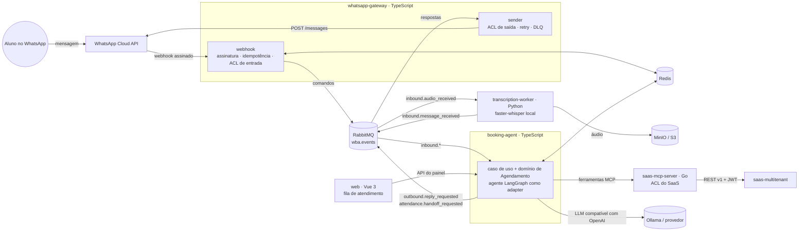
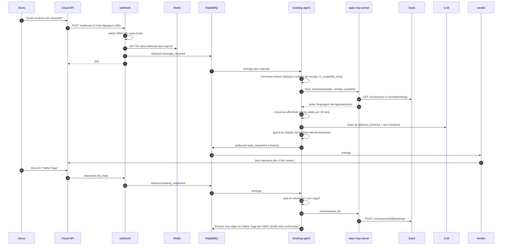
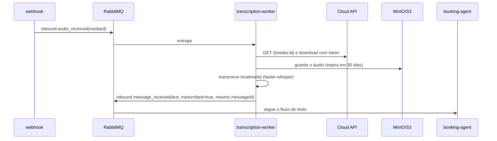
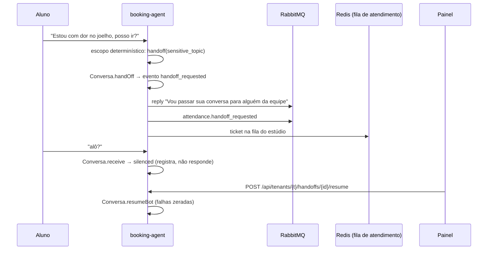

# Design doc: agente de agendamento via WhatsApp

| | |
| --- | --- |
| Status | Fundação implementada (rodada 1) |
| Autor | Johnny Santos |
| Última revisão | 2026-11-21 |
| Depende de | [saas-multitenant](https://github.com/JohnnyMatteus/saas-multitenant) (API REST v1 de agenda) |

## 1. Contexto

Os estúdios de yoga e pilates que usam o SaaS de agendamento (projeto `saas-multitenant`) recebem pelo WhatsApp boa parte dos pedidos dos alunos: "tem aula amanhã cedo?", "me tira da aula de quinta", "lotou? me coloca na fila". A recepção responde à mão, copia o horário da grade do SaaS e faz a reserva por lá. Nos horários de pico, a resposta demora e a vaga vai para quem pediu depois.

Este projeto coloca um agente no número de WhatsApp Business do estúdio. Ele mostra horários, reserva, cancela e coloca na lista de espera usando a própria API do SaaS, e passa a conversa para uma pessoa quando o assunto sai da agenda.

Duas restrições externas moldam o desenho:

1. **Somente a WhatsApp Cloud API oficial.** Nada de bibliotecas que automatizam o WhatsApp Web: elas violam os termos da Meta e derrubam o número do estúdio.
2. **Desde 15/01/2026 a política da Meta proíbe chatbots de uso geral na plataforma.** O agente precisa ter escopo fechado e demonstrável: aulas e reservas. Pedido fora disso recebe uma recusa educada.

## 2. Objetivos e não-objetivos

**Objetivos**

- O aluno consulta horários, reserva, cancela e entra na lista de espera pelo WhatsApp, em linguagem natural, botões, listas, Flows ou áudio.
- O bot **só cita horários que vieram das ferramentas** (a API do SaaS), com garantia por código e teste que prova.
- Escopo fechado com recusa educada, decidido por um classificador determinístico mais o LLM, sem que o LLM consiga reverter o determinístico.
- Transferência para humano por pedido explícito, por falha repetida ou por tema sensível. Transferida, a conversa vai para a fila de atendimento e o bot para de responder.
- Webhook seguro (X-Hub-Signature-256) e idempotente pelo id da mensagem.
- Nenhum tipo da Meta ou do SaaS dentro do domínio (Anti-Corruption Layer nos dois pontos).

**Não-objetivos nesta fundação**

- Atendimento humano completo (caixa de entrada para o atendente responder pelo painel). Nesta rodada o painel mostra a fila e devolve a conversa ao bot.
- Vínculo telefone → aluno no SaaS e token exchange no Keycloak (o servidor MCP usa token de desenvolvimento por estúdio).
- Mensagens proativas por template (lembrete de aula, aviso de promoção da fila). Fora da janela de 24 horas da Meta, só template aprovado pode ser enviado.
- Pagamentos, planos, cadastro de aluno: são temas sensíveis e vão para humano.

## 3. Arquitetura

Clean Architecture + Hexagonal + DDD, em microsserviços, no mesmo padrão dos outros projetos do portfólio. O mapa de serviços e o motivo de cada fronteira estão no [ADR 0001](adr/0001-mapa-de-servicos.md).

**Camadas no booking-agent** (onde está o domínio):

| Camada | Pasta | Conhece |
| --- | --- | --- |
| Domínio | `src/domain` | nada externo (o ESLint bloqueia imports de framework, fila, LLM e contratos) |
| Aplicação | `src/application` | domínio e portas (`SchedulingTools`, `ConversationRepository`, `HandoffQueue`, `OutboundPublisher`, `ConversationAgent`) |
| Agente (adapter de aplicação) | `src/agent` | LangGraph, porta do LLM, domínio |
| Adaptadores | `src/adapters` | MCP, RabbitMQ, Redis, HTTP, LLM |

### 3.1 Anti-Corruption Layer em dois pontos

Detalhes e custo no [ADR 0002](adr/0002-anti-corruption-layer.md).

1. **WhatsApp** (`services/whatsapp-gateway/src/acl`): o payload da Cloud API (webhook, texto, áudio, interativos de lista e botão, conclusão de Flow, resposta de template, status de entrega e tipos desconhecidos) vira comandos e eventos da linguagem publicada: `MensagemRecebida` (`inbound.message_received`), `PedidoDeReserva` (`inbound.booking_requested`), `PedidoDeCancelamento` (`inbound.cancellation_requested`), pedido de lista de espera, áudio recebido e mudança de status. Na saída, a resposta neutra do domínio (texto ou opções) vira texto, botões ou lista da Cloud API, respeitando os limites da Meta. Os tipos da Meta vivem num único arquivo (`cloud-api-types.ts`).
2. **SaaS** (`services/saas-mcp-server/internal/adapters/saas`): `SessionResource`, `BookingResource` e `problem+json` do SaaS viram `Aula`, `Reserva` e erros de domínio com códigos estáveis. Uma segunda barreira no booking-agent (`adapters/mcp/scheduling-tools.ts`) valida a resposta das ferramentas por schema e reconstrói os agregados, reaplicando as invariantes.

## 4. Modelo de dados

### 4.1 Domínio de Agendamento (booking-agent)

Os nomes de código são em inglês; o vocabulário de negócio é o da tabela. O roteiro [modelo de domínio](roteiros/modelo-dominio-agendamento.md) explica cada invariante.

| Agregado | Classe | Invariantes principais |
| --- | --- | --- |
| Aula | `ClassSession` | fim depois do início; capacidade inteira positiva; confirmados entre 0 e a capacidade; fila só existe com aula lotada; fuso IANA válido; começou = não aceita reserva, cancelamento nem fila |
| Reserva | `Booking` | `confirmed` → `canceled`; `waitlisted` → `confirmed` (promoção) ou `canceled`; cancelada é final; cancelar vaga confirmada libera lugar |
| Lista de espera | `Waitlist` | só em aula lotada e não começada; aluno entra uma vez; quem tem vaga não entra; FIFO, a posição de quem entra é o fim da fila |
| Conversa | `Conversation` | cada mensagem processada uma vez; o aluno só escolhe entre as opções da última oferta, válida por 30 minutos; 2 falhas seguidas transferem para humano; transferida, o bot não oferece nada e só registra as mensagens; transferir é idempotente |

A política de escopo (`scope-policy.ts`) também é domínio: função pura que classifica o texto em `handoff`, `out_of_scope`, `in_scope(intenção)` ou `undecided`.

### 4.2 Linguagem publicada (fila)

Envelope versionado (`packages/contracts`): `{ id, type, version: 1, occurredAt, correlationId, payload }`. A routing key é o `type`; o `correlationId` é o id da mensagem original do WhatsApp e atravessa todos os saltos.

| type | Produtor | Consumidor | Payload (resumo) |
| --- | --- | --- | --- |
| `inbound.message_received` | gateway, worker | booking-agent | origem + `text` (com `transcribed`) ou `unsupported` |
| `inbound.audio_received` | gateway | transcription-worker | origem + `mediaId`, `mimeType` |
| `inbound.booking_requested` | gateway | booking-agent | origem + `sessionId`, `source` (`list`, `button`, `form`) |
| `inbound.cancellation_requested` | gateway | booking-agent | origem + `bookingId`, `source` |
| `inbound.waitlist_requested` | gateway | booking-agent | origem + `sessionId`, `source` |
| `inbound.delivery_status_changed` | gateway | booking-agent (métrica) | `messageId`, `status`, `errorCode?` |
| `outbound.reply_requested` | booking-agent | sender | `contactId`, `content` (`text` ou `choices`) |
| `attendance.handoff_requested` | booking-agent | fila `attendance.handoffs` | `conversationId`, `reason`, `requestedAt` |

Origem = `tenantId`, `contactId`, `messageId`, `receivedAt`.

### 4.3 Ferramentas MCP (saas-mcp-server)

| Ferramenta | Entrada | Saída |
| --- | --- | --- |
| `listar_horarios` | `estudio`, `contato`, `de`, `ate` (datas locais) | `aulas[]` com vagas, fila e `minha_reserva` |
| `reservar` | `estudio`, `contato`, `aula_id` | `reserva` (`confirmada` ou `em_espera` se a vaga acabou no caminho); aula lotada = erro `aula_lotada` |
| `cancelar` | `estudio`, `contato`, `reserva_id` | `reserva` cancelada e `fila_promovida` |
| `entrar_lista_espera` | `estudio`, `contato`, `aula_id` | `reserva` em espera; aula com vaga = erro `ha_vagas` |

Erro de domínio volta como resultado `isError` com `{codigo, mensagem, retentavel}`. `estudio` e `contato` são preenchidos pelo código a partir da conversa, nunca pelo LLM.

### 4.4 Estado no Redis

| Chave | Conteúdo | TTL |
| --- | --- | --- |
| `wba:webhook:seen:<id>` | marca de idempotência do webhook (id da mensagem ou id + status) | 7 dias (janela de reentrega da Meta) |
| `wba:conversation:<tenant>:<contato>` | snapshot JSON da Conversa com `version` (compare-and-set em Lua) | 30 dias |
| `wba:handoffs:<tenant>:tickets` / `:order` | fila de atendimento (hash + sorted set por hora do pedido) | até a devolução ao bot |

## 5. Fluxos principais

### 5.1 Texto → lista de horários → reserva por botão

### 5.2 Áudio

### 5.3 Transferência para humano

### 5.4 Envio com retry e DLQ

O sender consome `whatsapp-sender.replies`. Erro transitório da Cloud API (429, 5xx, rede, códigos de limite de taxa) vai para `whatsapp-sender.replies.retry` (TTL) e volta; depois de 5 tentativas vai para `.dlq`. Erro permanente (número inválido, janela de 24 horas expirada, token) vai direto para a DLQ com o motivo nos headers. Ver [ADR 0006](adr/0006-mensageria-rabbitmq.md).

## 6. Falhas e como são tratadas

| Falha | Tratamento |
| --- | --- |
| Assinatura inválida | 401, nada publicado, métrica `invalid_signature` e alerta |
| Webhook assinado mas fora do formato | 200 (reenvio não adiantaria), log de erro, nada publicado |
| Reentrega da Meta | idempotência no Redis: publica uma vez |
| RabbitMQ fora ao publicar no webhook | libera a chave de idempotência e responde 500: a Meta reentrega |
| Mensagem fora do contrato na fila | DLQ direto, sem retry |
| Redelivery no booking-agent | `Conversation.receive` deduplica pelo id |
| Dois consumidores na mesma conversa | compare-and-set por versão no Redis; o perdedor volta para a fila |
| LLM devolve JSON inválido ou cita horário | um retry com o motivo da rejeição; persistindo, interpretação vira falha e a frase de abertura cai para texto fixo |
| LLM fora do ar | conta como falha; o aluno recebe "indisponível" |
| SaaS fora do ar ou 5xx | `saas_indisponivel` retentável → falha do bot com resposta ao aluno |
| Regra de negócio do SaaS (conflito de horário, prazo de cancelamento) | erro de domínio mapeado → resposta explicando; não conta como falha |
| 2 falhas seguidas | transferência para humano por `repeated_failure` |
| Publicar resposta e cair antes de salvar | a reentrega responde de novo (duplicata rara, preferida à perda; outbox é próximo passo) |
| Cloud API 429/5xx | retry com TTL até 5 vezes, depois DLQ |
| Cloud API 4xx definitivo | DLQ direto (`PermanentFailure`) |

## 7. Segurança

- **Webhook**: HMAC-SHA256 do corpo bruto com o App Secret, comparação em tempo constante; token do handshake também em tempo constante; limite de 256 KB por requisição.
- **Somente a Cloud API oficial**, com token de sistema guardado fora do código (`.env` em desenvolvimento, cofre em produção).
- **Identidade nas ferramentas** sempre vinda da conversa (estúdio pelo número que recebeu a mensagem, contato pelo remetente). O LLM não preenche argumento de identidade e não chama ferramentas.
- **Servidor MCP** em rede interna e protegido por token compartilhado; o SaaS continua aplicando isolamento por tenant e RBAC pelo JWT.
- **Dados pessoais (LGPD)**: telefone e texto do aluno são censurados nos logs (redação no pino); erros nunca incluem corpo de resposta da Meta, do SaaS ou do LLM (podem ecoar a mensagem); o painel recebe o contato mascarado; o áudio expira em 30 dias no bucket; a transcrição é local, então a voz do aluno não vai para API de terceiros.
- **OWASP API**: validação de entrada por schema em todas as fronteiras (webhook, fila, ferramentas, LLM, configuração); sem SSRF (URLs de mídia só da Cloud API configurada); falha de configuração derruba o processo na subida citando só o nome da variável.
- **Painel**: token provisório injetado pelo proxy (nunca no navegador); a troca por OIDC no Keycloak do SaaS está nos próximos passos.

## 8. Observabilidade

| Sinal | Como |
| --- | --- |
| Logs | JSON em stdout (pino nos serviços Node, slog no Go, logging no Python), com `service`, `correlationId` (id da mensagem do WhatsApp), `trace_id` e `span_id`; telefone e texto censurados |
| Métricas | Prometheus em `/metrics` de cada serviço: `wba_webhook_requests_total`, `wba_webhook_items_total{type,outcome}`, `wba_agent_turns_total{outcome}`, `wba_handoffs_total{reason}`, `wba_llm_output_rejected_total{stage}`, `wba_citation_violations_total`, `wba_queue_messages_total{queue,result}`, `wba_outbound_messages_total`, `wba_cloud_api_request_seconds`, `wba_mcp_tool_calls_total{tool,result}`, `wba_saas_request_seconds{route,status}` |
| Traces | OpenTelemetry com propagação W3C pelos headers do RabbitMQ e pelo HTTP do MCP até o SaaS; exportação OTLP para o Jaeger quando `OTEL_EXPORTER_OTLP_ENDPOINT` está definido |
| Alertas | `infra/prometheus/alerts.yml`: citação fora das ferramentas (page), assinatura inválida, mensagens na DLQ e taxa de transferência por falha acima de 5% |

## 9. Alternativas consideradas

| Alternativa | Por que não |
| --- | --- |
| Bibliotecas não oficiais do WhatsApp Web | violam os termos da Meta e derrubam o número; ver [ADR 0003](adr/0003-escopo-fechado-e-recusas.md) |
| Agente ReAct livre, com o LLM chamando as ferramentas | o LLM poderia inventar ids, horários e identidade; o grafo com nós fixos é previsível e testável ([ADR 0008](adr/0008-agente-langgraph-como-adapter.md)) |
| Monólito único com webhook, agente e envio | o webhook precisa responder rápido e escalar diferente do agente (que espera LLM); o envio tem retry próprio |
| Domínio direto sobre os tipos do SaaS | qualquer mudança do SaaS vazaria para as regras do bot; ACL isola ([ADR 0002](adr/0002-anti-corruption-layer.md)) |
| Kafka em vez de RabbitMQ | o problema é fila de trabalho com retry e DLQ por consumidor, não log de eventos com replay ([ADR 0006](adr/0006-mensageria-rabbitmq.md)) |
| Transcrição por API de terceiros | voz do aluno sairia da infraestrutura do estúdio; custo por minuto |
| Sender separado em serviço próprio | duplicaria a ACL da Cloud API; ficou no gateway, em processo separado ([ADR 0001](adr/0001-mapa-de-servicos.md)) |

## 10. Custos e riscos humanos

- **LLM**: só é chamado quando a política determinística não decide (interpretação) e para a frase de abertura de listas. Saudação, recusa óbvia, pedido de humano, temas sensíveis e cliques em botões não chamam o modelo. Em desenvolvimento roda local (Ollama, custo zero); em produção, modelo pequeno basta (classificação e uma frase).
- **Cloud API**: respostas dentro da janela de atendimento de 24 horas iniciada pelo aluno não usam template pago.
- **Riscos humanos**: um bot que opina sobre dor, gravidez ou cobrança pode causar dano. Esses temas vão sempre para humano, por regra determinística que o LLM não reverte. O bot nunca promete o que a ferramenta não confirmou.

## 11. Cursos exercitados

Conforme `courses.yaml` (`exercised_by: whatsapp-booking-agent`):

| Curso | Onde aparece |
| --- | --- |
| FC4 Design de APIs | webhook, contratos versionados, erros com código estável, ferramentas MCP |
| FC4 Testes avançados | testes de contrato com payloads reais anonimizados, regressão do guard de citação, integração com testcontainers |
| FC4 Hexagonal e Clean Architecture | portas e adaptadores em todos os serviços; domínio sem framework, garantido pelo lint |
| FC4 RabbitMQ | topologia com filas quorum, retry com TTL, DLQ, ack manual, publisher confirms |
| FC4 DDD e eventos | agregados com invariantes, linguagem publicada, ACL, eventos de domínio |
| FC4 OWASP e Vault | assinatura do webhook, validação nas fronteiras, redação de dados pessoais, segredos fora do código |
| UNIPDS 9.2 Ollama | LLM local em desenvolvimento pela API compatível com OpenAI |
| UNIPDS 4.3 Tool use | servidor MCP em Go com quatro ferramentas, chamado pelo código do grafo |
| UNIPDS 4.4 Memória | a Conversa guarda a oferta, as falhas e as mensagens processadas |
| UNIPDS 4.5 Contexto | o LLM recebe só a mensagem e as ofertas vigentes, não o histórico inteiro |
| UNIPDS 4.7 Autonomia | transferência para humano e limites do que o bot decide sozinho |
| UNIPDS 8.m4 Padrões de IA | roteamento determinístico antes do LLM, validação por schema com retry |
| UNIPDS 10 Riscos e custos | temas sensíveis para humano, LLM só no ambíguo, transcrição local |

## 12. Plano de evolução (próximos passos)

1. **Identidade real do aluno**: vínculo telefone → aluno no SaaS (opt-in com código de verificação) e token exchange (RFC 8693) no Keycloak, no lugar do `StaticTokenSource`.
2. **Caixa de entrada humana** no painel: ver o histórico, responder pelo painel (via sender) e encerrar o atendimento. Hoje a fila mostra e devolve ao bot.
3. **Outbox** no booking-agent para publicar e salvar atomicamente, e **serialização por contato** (consistent hash exchange ou single active consumer por partição) para eliminar a corrida resolvida hoje por compare-and-set e retry.
4. **Templates aprovados** para avisar promoção da lista de espera e lembrar aula (fora da janela de 24 horas).
5. **Flow de agendamento publicado** na Meta (o tradutor já entende a conclusão `{action, target_id}`).
6. **transcription-worker**: retry com TTL e DLQ iguais aos serviços Node, métricas Prometheus e teste de integração com MinIO.
7. **Testes avançados**: mutação no domínio (Stryker) e carga no webhook (k6) no CI.
8. **Painel com login** OIDC no Keycloak do SaaS, conversas e métricas de atendimento.
9. **Deploy**: Helm e GitOps no padrão do `platform-edge`, atrás do gateway compartilhado.
